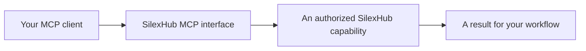

  
  <h1>SilexHub MCP</h1>
  
<strong>Tools, data, and software connections for AI agents.</strong>

  
The official integration hub for connecting AI agents to SilexHub capabilities.

  
<a href="https://github.com/silexhub/silexhub">Developer hub</a> · <a href="https://github.com/silexhub/docs">Documentation</a> · <a href="https://github.com/silexhub/mcp-server">MCP integration</a> · <a href="https://github.com/silexhub/silexhub/blob/main/README.zh-CN.md">简体中文</a>

  

---

This repository brings together SilexHub's public MCP connection guidance, capability contract, and release requirements. MCP is the integration layer through which a compatible agent can discover capabilities and request a result within an authorized scope.

**Current status: integration documentation is available; the SilexHub MCP service is not released.** There is no supported endpoint, installable package, or client configuration to run today. Runnable connection instructions will be added when the first real capability passes its release checks.

## Start here

| Guide | What it answers |
| --- | --- |
| [Connection guide](docs/connection-guide.md) | How hosted and local connections differ; where verified configuration will appear |
| [Capability contract](docs/capability-contract.md) | What a tool must explain about inputs, outputs, permissions, and failures |
| [Release readiness](docs/release-readiness.md) | What must work before an integration is called available |
| [Product documentation](https://github.com/silexhub/docs) | Product concepts, workflow design, and current availability |

## How the integration fits

The first connection is planned as a hosted integration. A separately installable adapter will be added here only when there is a supported need for it. Published adapter code will contain the public integration layer; SilexHub's hosted application and service implementation are maintained separately.

## For people and agents

People choose a capability and authorize access. An agent supplies the documented inputs and consumes the result. The capability's documentation must make the task, scope, usage rules, and error behavior clear before it is used.

We are starting from a concrete job rather than a large tool list. The first usable integration will include a tested client setup, a successful task, and the relevant failure and permission checks.

## 中文说明

这里是SilexHub官方MCP接入仓，先提供连接指引、能力约定和发布条件。当前尚无可用的公开MCP服务、安装包或连接配置；首个真实能力验收后，再补经过验证的运行方式。本站业务实现、支付与私有数据不放进本仓。

## Questions and contributions

For a capability request, [describe your task in the developer hub](https://github.com/silexhub/silexhub/issues/new). For a correction to these integration documents, open an issue or pull request here. Use synthetic examples and never include credentials or confidential records.
